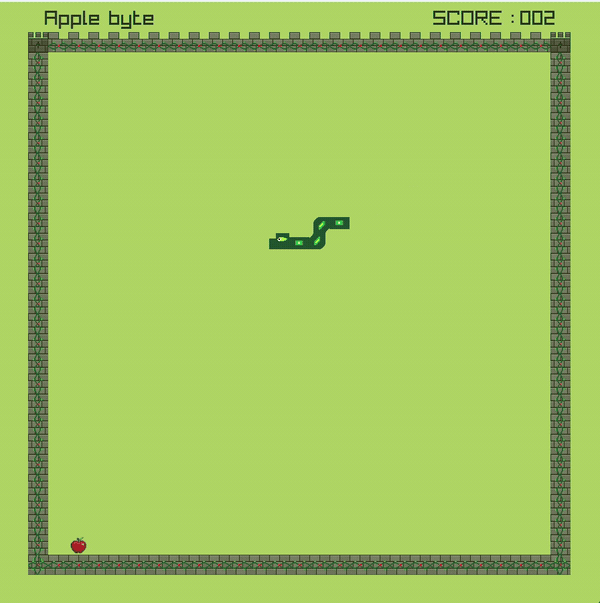

# 🍎 Apple Byte

A classic Snake game built with **C++** and **Raylib**, featuring custom textures, sound effects, and a simple visual design.


## 🎮 About the Game

Apple Byte is a Snake game where the player controls a snake, collects food, and tries to grow without colliding with the walls or its own body.

This project was built as a learning experience to explore C++ programming, object-oriented programming, and game development using Raylib.

## ✨ Features

- Classic Snake gameplay
- Snake movement using keyboard controls
- Food collection and snake growth
- Wall and self-collision detection
- Score tracking
- Custom snake and food textures
- Sound effects for eating and game over
- Custom game border

## 🕹️ Controls

| Key | Action |
|---|---|
| ↑ Up Arrow | Move Up |
| ↓ Down Arrow | Move Down |
| ← Left Arrow | Move Left |
| → Right Arrow | Move Right |

## 🛠️ Built With

- **C++** — Game logic and programming
- **Raylib** — Graphics, input, audio, and game window
- **STL Deque** — Managing the snake's body

## 📁 Project Structure

```text
Apple-Byte/
│
├── graphics/
│   ├── food.png
│   ├── Head.png
│   ├── Body.png
│   ├── Corner_body.png
│   ├── border.png
│   └── Border Parts/
│
├── sounds/
│   ├── eat.wav
│   └── gameover.mp3
│
├── main.cpp
└── README.md
```

## ⚙️ Getting Started

### Prerequisites

- A C++ compiler
- Raylib installed and configured
- A development environment such as Visual Studio Code

### Run the Game

1. Clone this repository:

   ```bash
   git clone https://github.com/thakkarneil70-maker/Apple-Byte.git
   ```

2. Open the project directory:

   ```bash
   cd Apple-Byte
   ```

3. Configure Raylib with your C++ compiler.

4. Compile and run `main.cpp` using your Raylib build configuration.

**Note:** Keep the `graphics` and `sounds` folders in the same directory as the executable because the game loads its assets using relative paths.

## 📚 What I Learned

Through this project, I explored:

- Using classes and objects in C++
- Constructors and destructors
- Working with the STL `deque` container
- Handling keyboard input and game timing
- Implementing collision detection
- Loading and managing textures and sounds
- Using Raylib for 2D game development

## 🚀 Future Improvements

- Add a start screen and game-over screen
- Improve the user interface
- Add more gameplay features

---

*Built as a personal learning project while exploring C++ and game development.*
